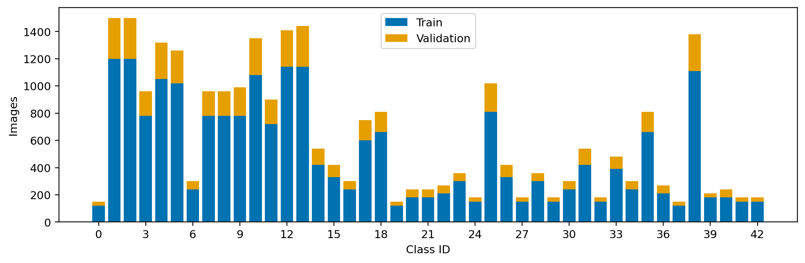
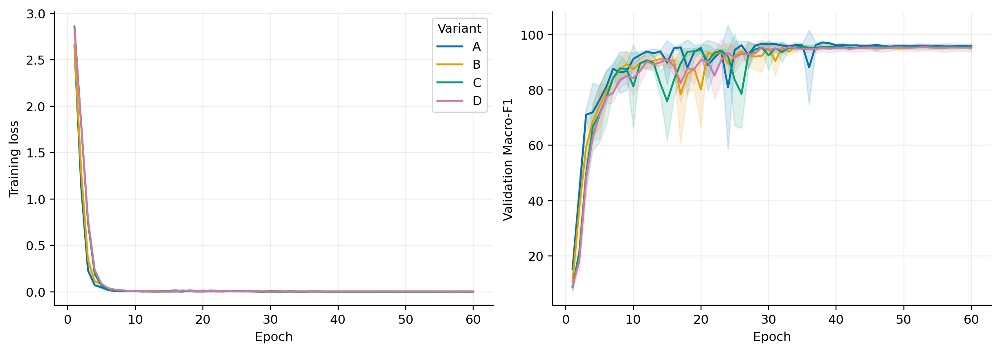
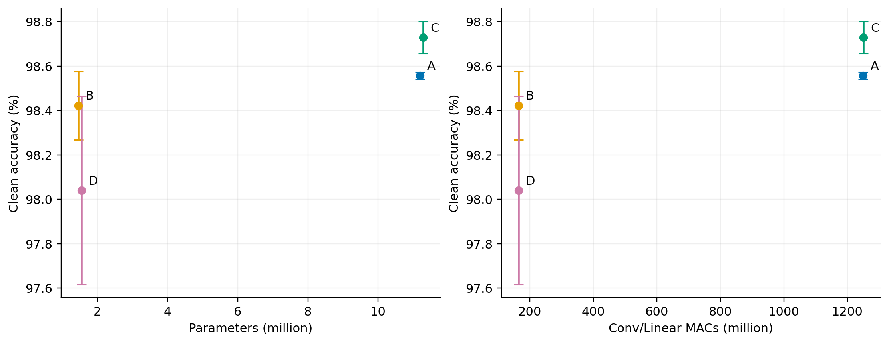
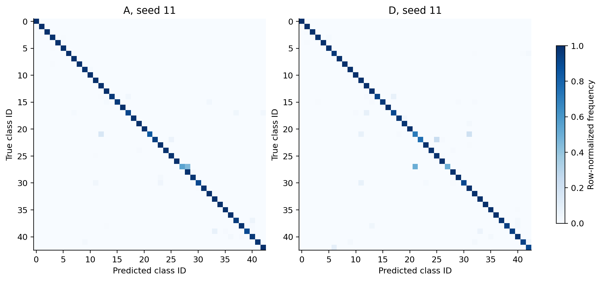
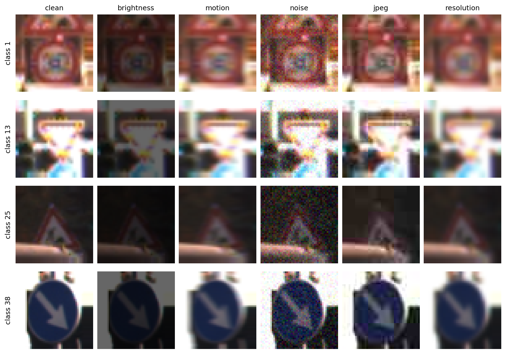
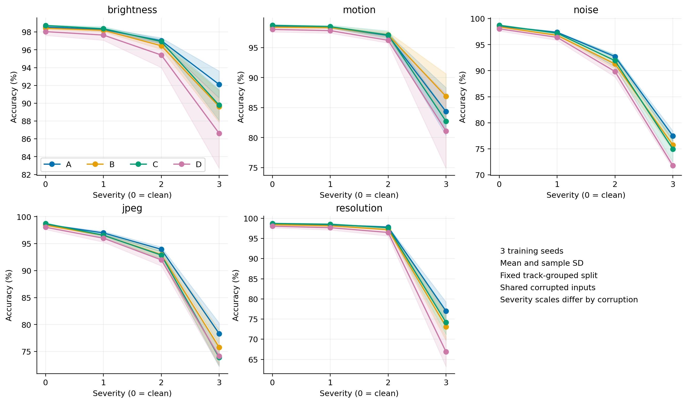
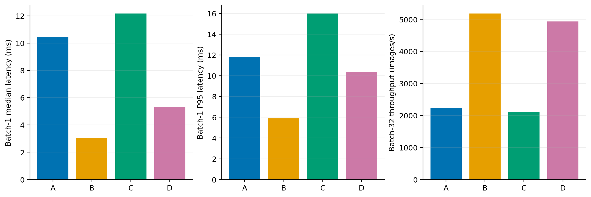
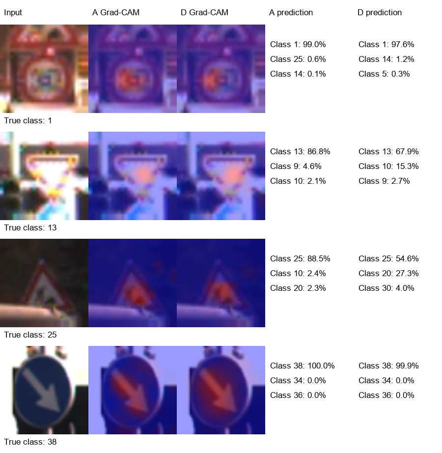

# 轻量化 ResNet 与 SE 注意力在交通标志识别中的应用研究

## 摘要

本项目针对裁剪交通标志的多类别图像分类，研究 CNN 结构对识别精度、模型复杂度和退化鲁棒性的影响。
以适配小尺寸图像的 ResNet-18 为基线，分别引入深度可分离卷积和 SE 通道注意力，构建四组控制变量实验。
使用 GTSRB 的 Training_fixed 数据版本，按完整拍摄序列分组划分训练集和验证集，并在固定官方测试集上评价。
每组使用3个训练种子，基线干净测试准确率为 98.56 ± 0.02%，
DW 组参数量减少 86.98%，Conv/Linear MACs 减少 86.85%，
其准确率相对基线变化 -0.13 个百分点。
SE 在标准卷积和 DW 骨架上的准确率变化分别为 +0.17 和 -0.38 个百分点。
此外，以五类固定合成退化和同一 GPU 上的实际计时分析结构取舍，不将理论 MACs 直接解释为硬件加速。

关键词：卷积神经网络；残差连接；深度可分离卷积；通道注意力；交通标志识别

## 1 任务背景与研究目标

交通标志的颜色、边缘轮廓和内部图案共同决定类别。小尺寸图片中的数字和方向图案可能相近，
光照、模糊和压缩还会进一步改变可见特征。因此，模型设计需要同时考虑干净输入上的识别能力、
计算资源和输入质量下降时的表现。

本项目的问题是：降低卷积复杂度会产生多大的精度代价；SE 在不同骨架上的识别表现如何变化；
结构变化是否同时改善理论复杂度与实际推理性能。目标不限定为改进模型必须超过基线。
本项目的输入是已裁剪的标志图片，不包含道路照片中的目标定位。
实验三复现的是 YOLO 和超分辨率算法；本项目在任务、数据处理、网络主体和消融设计上均与之不同。

## 2 模型原理与结构修改

### 2.1 残差卷积网络

ResNet 通过捷径连接将块输入与学习到的残差分支相加，使深层网络能够学习对已有表示的修正[1]。
本项目的四个残差阶段通道数为 64、128、256、512，每阶段两个 BasicBlock。
入口采用 3×3、步长为1的卷积并去除入口最大池化，以保留小图像细节。
后三个阶段首块执行下采样，随后全局平均池化并连接43类分类层。
该网络称为小图像适配版 ResNet-18，未直接宣称为原始 ImageNet 配置。

### 2.2 深度可分离卷积

标准 K×K 卷积同时完成空间和通道间的混合，不计偏置时参数量为核面积与输入、输出通道数的乘积。
深度可分离卷积先逐通道执行 K×K 空间滤波，再用1×1逐点卷积完成通道混合[2]。
其参数量为“核面积乘输入通道数”与“输入通道数乘输出通道数”之和。
当输入输出空间尺寸相同，MACs 可由相应卷积参数量乘输出位置数得到。

本项目只替换残差主分支中的3×3卷积，入口卷积和捷径投影保持一致。
DW 与 PW 之间不增加额外 BN 或激活，原主分支外部 BN/ReLU 位置不变，
避免将额外非线性与卷积类型的影响混在一起。

### 2.3 SE 通道注意力

SE 将特征图进行全局平均池化，通过压缩和恢复通道维度的两层映射产生权重，
再用 Sigmoid 得到每个通道的缩放系数[3]。本项目压缩比为16，
模块放在残差分支最后一个 BN 之后、与捷径相加之前。
SE 是已有方法，本项目的工作为任务适配、结构组合与实验分析。

四组模型在各阶段的空间尺寸相同：入口与stage1为48×48，stage2为24×24，
stage3为12×12，stage4为6×6。相加的两条分支若尺寸或通道数不同，
捷径通过步长匹配的1×1卷积和BN完成投影。

### 2.4 四组控制变量实验

| 组别 | 残差主分支卷积 | SE |
| --- | --- | --- |
| A | 标准卷积 | 无 |
| B | 深度可分离卷积 | 无 |
| C | 标准卷积 | 有 |
| D | 深度可分离卷积 | 有 |

主比较 B−A 对应轻量化，C−A 对应标准骨架注意力，D−B 对应轻量化骨架注意力。
另计算两种骨架上的注意力收益差，作为交互效应的描述统计。

## 3 数据处理与防泄漏

使用 GTSRB 的 `GTSRB-Training_fixed.zip` 数据版本，包含 26,640 张训练图片，
官方测试图片为 12,630 张。本项目没有使用常见的39,209张最终训练版本；
因此不能直接将本项目与采用该版本或其他裁剪方法的文献数值作公平排名。
图片 ZIP 通过 torchvision 所列 MD5 校验。由于原托管地址连接失败，
实际下载使用公开原 ZIP 镜像；测试标签镜像校验 SHA256，并核对编号、图片尺寸及 ROI。

同一标志拍摄序列的连续帧可能高度相似。使用类别ID与文件名前缀共同构成 track 键，
固定划分种子2026，在每类内划分完整序列。
得到训练集 21,360 张、712 个序列，
验证集 5,280 张、176 个序列，
两者序列交集为 0。所有模型与训练种子共用同一划分。
没有将随机相邻帧拆分后得到的高验证准确率作为依据。

所有图片保持长宽比，以边缘像素补成正方形后双线性缩放至48×48。
不使用ROI进一步裁剪，固定各通道均值和标准差为0.5进行归一化。
训练增强采用±10°旋转、±5%平移、0.95–1.05缩放和0.8–1.2亮度变化，不进行翻转。



## 4 实验设置与评价协议

实验 GPU 为 NVIDIA GeForce RTX 4060 Laptop GPU，PyTorch 2.7.1+cu118，CUDA运行库 11.8。
模型从随机初始化开始训练，统一使用 60 个epoch、batch size 128、
SGD动量 0.9、权重衰减 0.0005、初始学习率 0.05。
学习率前 5 轮预热，之后余弦衰减至 0.0001。
训练启用AMP FP16，验证和最终推理使用FP32，关闭TF32。
训练种子为[11, 22, 33]，不以测试集选出最佳种子。

模型按验证 Macro-F1 最大的epoch选择，平局时优先较低验证损失，再优先较早epoch。
模型、训练规则和退化参数冻结后统一评价测试集，不根据测试结果修改超参数。
种子11的测试结果已在扩展之前查看；随后按用户要求，统一补充种子22和33，这属于查看结果后的重复实验扩展，不宣称全部重复均在首次测试之前预注册。结构、训练预算、数据划分、检查点选择和退化参数保持不变，三个种子全部纳入汇总。种子11仍引用原协议和原预测文件，未为适配新协议重写结果。
Accuracy为正确预测图片数占比；Macro-F1对全部43类F1等权平均，
未预测出的类别按零处理。表中“±”为3个训练种子的样本标准差，而非置信区间。

## 5 干净测试结果与消融分析

| 组别 | Accuracy % | Macro-F1 % | 参数量 | MACs M |
| --- | --- | --- | --- | --- |
| A | 98.56 ± 0.02 | 97.35 ± 0.28 | 11,190,891 | 1249.712 |
| B | 98.42 ± 0.15 | 97.31 ± 0.31 | 1,456,555 | 164.371 |
| C | 98.73 ± 0.07 | 97.69 ± 0.33 | 11,279,971 | 1249.799 |
| D | 98.04 ± 0.42 | 96.88 ± 0.97 | 1,545,635 | 164.458 |

基线stage1占全模型Conv/Linear MACs的27.19%，但各后续stage仍有接近的计算贡献。因此，小图像入口适配提高了浅层空间分辨率，计算压缩不能只看参数最多的深层。SE增加89,080个参数，相对A增加0.80%，相对B增加6.12%；同一模块的相对开销取决于参照骨架。

本次3个种子的汇总中，干净测试平均准确率最高的是C组。四组干净精度差异应结合具体百分点、错误数量和Macro-F1理解，不能因模型包含更多模块就预设其更优。

基线A的干净测试准确率为 98.56 ± 0.02%。
B相对A的准确率变化为 -0.135 个百分点，
同时参数和Conv/Linear MACs分别减少 86.98% 和 86.85%。
这组结果应与实际延迟和退化结果共同判断，不能只据参数量选择最终模型。

C相对A、D相对B的准确率变化分别为 +0.172 和 -0.383 个百分点。
下表列出同种子配对差值及其样本标准差，不能仅凭平均数或标准差就宣称统计显著。

| 对比 | 平均准确率差 pp | 差值标准差 pp |
| --- | --- | --- |
| DW effect | -0.135 | 0.137 |
| SE standard | +0.172 | 0.072 |
| SE depthwise | -0.383 | 0.521 |
| SE interaction | -0.554 | 0.477 |

B−A（DW替换）的准确率差为：种子11为-0.206、种子22为-0.222、种子33为+0.024个百分点，其中1/3个种子的差值为正。C−A（标准骨架加入SE）的准确率差为：种子11为+0.095、种子22为+0.238、种子33为+0.182个百分点，其中3/3个种子的差值为正。D−B（DW骨架加入SE）的准确率差为：种子11为-0.570、种子22为+0.206、种子33为-0.784个百分点，其中1/3个种子的差值为正。D组准确率的跨种子标准差为0.423个百分点，A组为0.016个百分点。这些结果说明组合结构的收益具有骨架和训练随机性的依赖；三个种子仅支持描述性比较，不能将同方向差值直接解释为统计显著。



训练曲线用于检查收敛、过拟合以及固定训练预算的限制。
曲线表示全部训练种子的算术均值，阴影表示均值上下一个样本标准差；阴影不是置信区间。
各模型均使用同一预算，这不等同于证明各架构已达到其所有可能超参数下的最优性能。



### 5.1 每个种子的原始结果

| 组别 | 种子 | Accuracy % | Macro-F1 % | 正确数 / 总数 | 最佳 epoch |
| --- | --- | --- | --- | --- | --- |
| A | 11 | 98.55 | 97.05 | 12447 / 12630 | 26 |
| A | 22 | 98.54 | 97.41 | 12446 / 12630 | 38 |
| A | 33 | 98.57 | 97.59 | 12450 / 12630 | 29 |
| B | 11 | 98.35 | 97.00 | 12421 / 12630 | 34 |
| B | 22 | 98.32 | 97.30 | 12418 / 12630 | 31 |
| B | 33 | 98.60 | 97.63 | 12453 / 12630 | 40 |
| C | 11 | 98.65 | 97.36 | 12459 / 12630 | 35 |
| C | 22 | 98.78 | 97.71 | 12476 / 12630 | 52 |
| C | 33 | 98.76 | 98.01 | 12473 / 12630 | 29 |
| D | 11 | 97.78 | 96.01 | 12349 / 12630 | 33 |
| D | 22 | 98.53 | 97.94 | 12444 / 12630 | 57 |
| D | 33 | 97.81 | 96.70 | 12354 / 12630 | 29 |

### 5.2 错误类型

以下使用预先指定的seed11，列出A与D中出现最多的非对角混淆，不按测试准确率选择展示种子。
类别中文含义可在代码 `src/labels.py` 中查到。错误数量不能直接解释为某类别更难，
还需考虑每类支持样本数、拍摄条件和外观相似性。

| 组别 seed11 | 真实类别 | 预测类别 | 错误图片数 |
| --- | --- | --- | --- |
| A | 27 行人 | 28 儿童 | 27 |
| A | 21 连续弯路 | 12 优先道路 | 14 |
| A | 17 禁止驶入 | 37 直行或左转 | 13 |
| A | 17 禁止驶入 | 42 解除3.5吨以上车辆禁止超车 | 11 |
| A | 14 停车让行 | 17 禁止驶入 | 8 |
| D | 27 行人 | 21 连续弯路 | 30 |
| D | 17 禁止驶入 | 12 优先道路 | 29 |
| D | 22 路面不平 | 25 道路施工 | 28 |
| D | 38 靠右行驶 | 13 减速让行 | 25 |
| D | 14 停车让行 | 17 禁止驶入 | 19 |

行人与儿童标志都包含三角轮廓和较小的人形图案，容易在低分辨率下混淆。
但还存在形状不同类别间的错误，仅凭混淆计数不能确定原因；
后续应逐图检查拍摄条件、背景与标签，避免把所有错误都归因于类别相似。



## 6 合成退化下的场景适配分析

固定五类退化，每类三档强度。亮度倍率为0.7、0.4、0.2；水平运动模糊核长3、5、9；
高斯噪声在归一到0–1的像素上标准差为0.03、0.06、0.12；JPEG quality为50、25、10；
降分辨率先缩至32、24、12再回采样到48。
所有退化都作用于同一标准预处理后的RGB输入，之后再转张量归一化。
随机噪声由样本ID和协议哈希固定，所有模型、种子使用完全相同的退化图像。



| 退化 | 强度 | A Accuracy % | B Accuracy % | C Accuracy % | D Accuracy % |
| --- | --- | --- | --- | --- | --- |
| 亮度降低 | 1 | 98.28 ± 0.15 | 98.19 ± 0.16 | 98.37 ± 0.22 | 97.65 ± 0.59 |
| 亮度降低 | 2 | 97.02 ± 0.33 | 96.46 ± 0.40 | 96.92 ± 0.25 | 95.41 ± 1.41 |
| 亮度降低 | 3 | 92.11 ± 1.51 | 89.63 ± 1.77 | 89.79 ± 1.73 | 86.62 ± 3.93 |
| 水平运动模糊 | 1 | 98.37 ± 0.01 | 98.34 ± 0.16 | 98.50 ± 0.23 | 97.84 ± 0.42 |
| 水平运动模糊 | 2 | 97.03 ± 0.29 | 97.14 ± 0.44 | 97.11 ± 0.68 | 96.23 ± 0.44 |
| 水平运动模糊 | 3 | 84.34 ± 3.99 | 86.87 ± 3.77 | 82.73 ± 1.68 | 81.09 ± 6.21 |
| 高斯噪声 | 1 | 97.37 ± 0.08 | 96.79 ± 0.08 | 97.19 ± 0.27 | 96.40 ± 0.56 |
| 高斯噪声 | 2 | 92.71 ± 0.29 | 91.29 ± 0.95 | 91.93 ± 1.18 | 89.84 ± 1.05 |
| 高斯噪声 | 3 | 77.47 ± 0.96 | 75.73 ± 1.03 | 74.96 ± 2.47 | 71.75 ± 0.50 |
| JPEG 压缩 | 1 | 96.99 ± 0.28 | 96.54 ± 0.11 | 96.55 ± 0.37 | 96.01 ± 0.72 |
| JPEG 压缩 | 2 | 93.95 ± 0.43 | 92.97 ± 1.05 | 92.87 ± 0.67 | 92.00 ± 1.12 |
| JPEG 压缩 | 3 | 78.32 ± 1.97 | 75.79 ± 3.24 | 73.90 ± 1.68 | 74.14 ± 1.82 |
| 分辨率降低 | 1 | 98.40 ± 0.04 | 98.14 ± 0.14 | 98.53 ± 0.15 | 97.68 ± 0.57 |
| 分辨率降低 | 2 | 97.83 ± 0.14 | 97.18 ± 0.16 | 97.65 ± 0.31 | 96.49 ± 0.87 |
| 分辨率降低 | 3 | 76.99 ± 2.26 | 73.11 ± 3.42 | 74.19 ± 3.04 | 66.90 ± 3.68 |

A 组在所设最高强度条件中，准确率下降最大的是分辨率降低，较本组干净输入下降 21.57 个百分点，该条件准确率为 76.99 ± 2.26%。

B 组在所设最高强度条件中，准确率下降最大的是分辨率降低，较本组干净输入下降 25.31 个百分点，该条件准确率为 73.11 ± 3.42%。

C 组在所设最高强度条件中，准确率下降最大的是JPEG 压缩，较本组干净输入下降 24.83 个百分点，该条件准确率为 73.90 ± 1.68%。

D 组在所设最高强度条件中，准确率下降最大的是分辨率降低，较本组干净输入下降 31.14 个百分点，该条件准确率为 66.90 ± 3.68%。

亮度降低的第3档强度下，C−A为-2.33个百分点，D−B为-3.01个百分点。水平运动模糊的第3档强度下，C−A为-1.61个百分点，D−B为-5.77个百分点。高斯噪声的第3档强度下，C−A为-2.51个百分点，D−B为-3.98个百分点。JPEG 压缩的第3档强度下，C−A为-4.43个百分点，D−B为-1.66个百分点。分辨率降低的第3档强度下，C−A为-2.80个百分点，D−B为-6.22个百分点。



这些结果支持的是所定义图像退化条件下的性能描述。亮度降低只模拟部分低照度影响，
水平模糊也不覆盖所有相机运动；本项目未采集真实夜间、雨雾或车载数据。
不同退化强度不具有统一物理尺度，因此主要逐类比较，不把跨种类平均分作为唯一排名。

## 7 实际推理性能

性能测试使用同一GPU、FP32、channels-last、eval与inference_mode，输入预先放在GPU。
batch=1预热50次、采样200次、重复3轮，以CUDA Events计时并逐次同步；
表中的中位延迟和P95分别取三轮对应统计量的中位数。
硬件测量统一使用固定种子11的检查点并沿用同一轮测量结果；三轮计时重复与三个训练种子不同，
不将该延迟表解释为跨训练种子的均值和标准差。
batch=32连续执行200批，仅在计时边界同步，以处理图片数除总时间计算吞吐。
该计时不包括读图、CPU预处理和主机到GPU传输，也不等同于完整应用响应时间。

| 组别 | 中位延迟 ms | P95 ms | 吞吐 images/s | 检查点 MB |
| --- | --- | --- | --- | --- |
| A | 10.465 | 11.834 | 2243.6 | 44.844 |
| B | 3.071 | 5.903 | 5185.8 | 5.912 |
| C | 12.176 | 16.005 | 2122.7 | 45.211 |
| D | 5.309 | 10.388 | 4932.0 | 6.279 |

B相对A的中位延迟变化为 -70.65%。
MACs计数只包含卷积与线性层的乘加，未计池化、归一化和逐元素操作；
即使理论复杂度下降，实际运行仍受算子实现、访存和kernel开销等因素影响。
本实验记录到的计时差异不能单独用于证明具体硬件瓶颈，若需定位应进一步使用分析器。
桌面GPU还承担显示任务，重复测量反映的波动保存在原始计时文件中。



## 8 应用与可复现运行

项目提供图片上传、模型选择、Top-3预测概率、固定退化对比及stage3的12×12 Grad-CAM。
热力图用于辅助观察，不作为注意力有效性的因果证明。分类概率未经校准，
模型也不具备可靠的未知类别拒识或道路照片目标定位能力。



图中样例沿用正式测试之前选定的四张验证图片，展示A与D的Top-3预测以及stage3关注区域。
没有根据测试集正确与否重新挑选展示图片；样本路径与概率另存于图像同名JSON文件。

代码仓库：https://github.com/CYBEZM/gtsrb-resnet18-dw-se-coursework

```powershell
python prepare_data.py --data-root data/gtsrb --mirror
python verify.py --data-root data/gtsrb
python inspect_data.py --data-root data/gtsrb
python freeze_protocol.py --data-root data/gtsrb
python run_experiments.py --data-root data/gtsrb
python -m streamlit run app.py
```

环境安装、GPU解释器核验、试跑、单次训练和断点恢复见仓库README。
每次运行保存实际配置、源码快照、数据清单哈希、环境版本与检查点校验值。
表图直接由JSON和日志生成，内部保留未舍入数值，正文仅在显示时舍入。

## 9 结论与局限

本项目完成经典残差CNN的实现、深度可分离卷积与SE两因素消融，
并将场景适配落实为固定退化条件的定量评价。
DW相对基线减少 86.98% 参数和 86.85% Conv/Linear MACs，
干净准确率变化 -0.135 个百分点；SE在两种骨架上的效果分别由C−A和D−B给出。
干净平均准确率最高的是C组。15项退化条件中，A组有10项平均准确率最高、B组有2项平均准确率最高、C组有3项平均准确率最高、D组有0项平均准确率最高（含并列）；这些条件的物理尺度不同，胜出次数只用于描述，不替代逐条件结果。B相对A的平均准确率差为-0.135个百分点，中位延迟变化为-70.65%。因此，实际选择应同时结合精度、退化类型与目标设备资源，不能预设组合模型最好。以上为本数据版本和固定划分下的任务适配判断，尚不能推广为真实道路部署结论。

局限包括单一数据集版本、单次固定分组划分、有限训练种子和单一GPU平台。样本标准差主要描述训练随机性，没有覆盖其他数据划分的不确定性。
合成退化不代表真实道路泛化，Grad-CAM也不能证明因果机制。
后续可在新增独立场景数据和更严格统计设计下验证结论，再考虑stage局部替换或低数据量实验。

## 附录 结果来源映射

| 表图 | 原始文件与字段 |
| --- | --- |
| 干净性能与逐种子结果 | runs/{variant}/{seed}/test_metrics.json: accuracy, macro_f1, correct, samples |
| 模型复杂度 | runs/{variant}/{seed}/complexity.json: parameters, conv_linear_macs |
| 训练曲线 | runs/{variant}/{seed}/log.csv |
| 鲁棒性 | runs/{variant}/{seed}/robustness_metrics.json |
| 推理性能 | report/profiles/{variant}.json: latency_runs, throughput_runs_images_s |
| 数据划分 | report/data/dataset_summary.json; data cache manifest.json |
| 汇总与来源校验 | report/tables/summary.json: source_files |
| 逐样本独立复核 | report/final_audit.json; runs/{variant}/{seed}/predictions/*.npz |

本报告输入汇总文件SHA256：`04c9f43d9a08fc8ee3698697fa39a1311ccf33a4e954ecaa62def766bcb2a865`。
数据清单SHA256：`209d45b5cf8f5caf3218658586be1ab6a6cb8b830221d7358c2f5a00f72a6502`。
冻结协议SHA256：`c2047458eb0981b4f12c36c2f1924d90413b7a7554041fd84aadd5150d5763df`。
历史种子评价协议按 `protocol_frozen.json` 的 `inherited_evaluations` 解析，并由哈希和固定字段一致性校验。

## 参考文献

[1] He K, Zhang X, Ren S, Sun J. Deep Residual Learning for Image Recognition. CVPR, 2016. https://arxiv.org/abs/1512.03385

[2] Howard A G, et al. MobileNets: Efficient Convolutional Neural Networks for Mobile Vision Applications. 2017. https://arxiv.org/abs/1704.04861

[3] Hu J, Shen L, Sun G. Squeeze-and-Excitation Networks. CVPR, 2018. https://arxiv.org/abs/1709.01507

[4] Stallkamp J, Schlipsing M, Salmen J, Igel C. Man vs. computer: Benchmarking machine learning algorithms for traffic sign recognition. Neural Networks, 2012. https://doi.org/10.1016/j.neunet.2012.02.016
