# 交通标志识别中残差CNN的轻量化、通道注意力与场景适配研究

内容整合稿 v1 · 供审阅，版式待调整

## 摘要

针对裁剪交通标志的多类别识别任务，本文从随机初始化实现小图像适配的ResNet-18，围绕深度可分离卷积（DW）、SE通道注意力及卷积替换位置构建五组模型。在GTSRB固定版本上完成15次训练，每次60轮，以干净分类、合成退化、设备计时和道路图像标注裁剪评价精度与资源开销。基线A的测试Accuracy为98.56 ± 0.02%，全阶段DW模型B减少86.98%参数和86.85%卷积/线性层MACs，准确率配对差为-0.135个百分点。标准卷积加SE的C组干净Accuracy为98.73 ± 0.07%，但其收益未延续到所有退化条件；DW与SE组合也没有取得叠加收益。仅替换深层的E组在低亮度条件下表现出不同的精度与开销取舍。这些结果说明，结构改动需要同时考察干净精度、类别错误、退化敏感性和目标设备性能。

关键词：ResNet-18；深度可分离卷积；SE；交通标志识别；鲁棒性

## 1 研究问题与总体流程

交通标志识别依赖轮廓、颜色与局部图案，但车载图像还会受到曝光、运动、噪声和编码压缩影响。较大的CNN能够拟合训练数据，却未必在资源受限设备上具有合适的推理开销。本实验关注三个问题：压缩卷积能以多大精度代价降低资源消耗；SE是否能改善不同骨架；保留浅层标准卷积、只压缩深层是否能改变这一取舍。

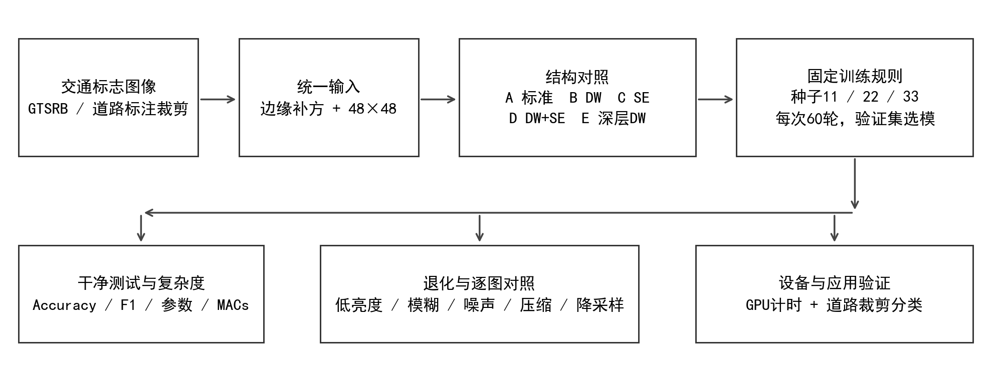

本文实现经典残差网络[1]，借鉴深度可分离卷积[2]与SE[3]进行任务适配。结构修改属于已有组件的受控组合与分析，不作为新的通用算法提出。与实验三的YOLO目标检测、超分辨率算法复现相比，本项目以分类CNN结构设计、消融及场景适配为主线。

## 2 模型设计与结构对照

### 2.1 小图像适配的ResNet-18

基线沿用四阶段残差骨架，每阶段包含两个BasicBlock，通道数依次为64、128、256、512。输入只有48×48，因此将原始大图入口改为3×3、stride=1，并移除maxpool，避免浅层过快丢失空间信息。四阶段输出空间尺寸为48、24、12、6，之后经全局平均池化和线性层输出43类。全部模型均从随机初始化训练。

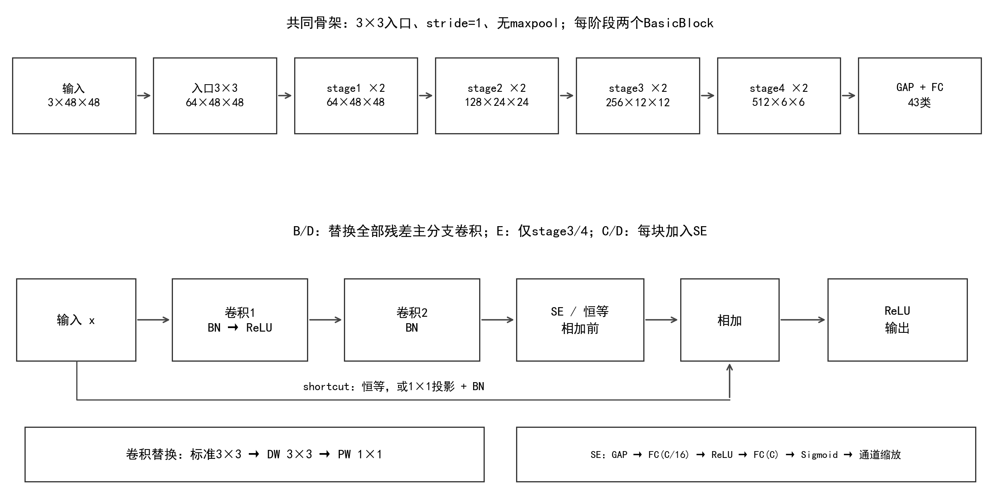

### 2.2 深度可分离卷积与SE

标准k×k卷积在每个输出位置的乘加次数为k²·Cin·Cout。DW先对每个输入通道独立作空间卷积，PW再用1×1卷积混合通道，对应k²·Cin + Cin·Cout。其相对计算量约为1/Cout + 1/k²。这只描述卷积乘加，不能直接作为实际加速比。实验保留入口及所有shortcut投影，只替换指定stage内残差主分支的3×3卷积，从而固定输入入口、下采样捷径与分类头。

SE先对主分支特征作全局平均池化，再通过C→C/16→C的两层全连接及Sigmoid得到通道权重。权重逐通道乘回主分支特征，随后与shortcut相加。它引入样本相关的通道重标定，是否改善识别必须由对应骨架的配对实验判断。

### 2.3 五组模型与比较关系

| 组别 | 主分支卷积 | SE | 回答的问题 |
| --- | --- | --- | --- |
| A | 全阶段标准卷积 | 无 | 经典残差CNN基线 |
| B | 全阶段DW+PW | 无 | B-A：全阶段轻量化 |
| C | 全阶段标准卷积 | 每块加入 | C-A：标准骨架上的SE |
| D | 全阶段DW+PW | 每块加入 | D-B：轻量骨架上的SE |
| E | stage1/2标准，stage3/4 DW+PW | 无 | E-A、E-B：替换位置的取舍 |

A-D构成卷积类型与SE两个因素的完整对照，E进一步考察DW替换位置。这里的轻量化目标包含参数、计算和设备表现，不能只按参数大小判定结构优劣。

## 3 数据、训练与评价方法

### 3.1 数据版本与分组划分

使用GTSRB[4]的Training_fixed版本，供给训练图片26,640张，官方测试集12,630张，覆盖43类。该训练版本不同于常见的39,209张最终训练版本。训练文件名前缀对应拍摄序列，编号可能在不同类别中重复，因此按(class_id, track_id)组成分组键，在每个类别内以划分种子2026划分完整序列。

| 子集 | 图片数 | 拍摄序列数 |
| --- | --- | --- |
| 训练 | 21,360 | 712 |
| 验证 | 5,280 | 176 |
| 官方测试 | 12,630 | 沿用官方集合 |

训练与验证的分组交集为0。分组划分避免同一实体标志的相邻帧跨入这两个子集；本文没有重新随机划分官方测试集。类别样本数不均衡，因此除整体Accuracy外还使用各类等权的Macro-F1。

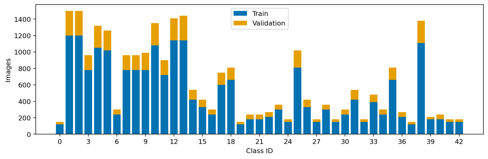

### 3.2 预处理与训练配置

对GTSRB保留原图内容，不按ROI裁剪。先以边缘像素补成正方形，再双线性缩放到48×48，最后以固定均值和标准差(0.5,0.5,0.5)归一化。补方保留原始长宽比例，避免将圆形或三角形直接拉伸。

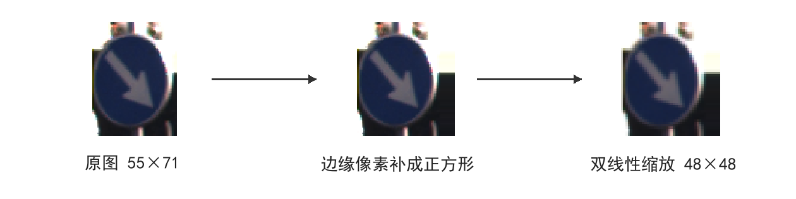

训练增强为逐图独立的±10°旋转、±5%平移、0.95-1.05缩放及0.8-1.2亮度变化，不进行翻转。GPU批量仿射增强采用双线性采样和边缘填充。

| 设置 | 统一取值 |
| --- | --- |
| 训练设备 | NVIDIA RTX 4060 Laptop GPU，8GB |
| 软件 | PyTorch 2.7.1+cu118；CUDA 11.8 |
| 初始化 / 随机种子 | 随机初始化；11、22、33 |
| 预算 / 批大小 | 每次60 epoch；batch=128 |
| 优化器 | SGD；momentum=0.9；weight_decay=0.0005 |
| 学习率 | 0.05；5轮线性预热后余弦衰减至0.0001 |
| 训练 / 评价精度 | 训练AMP FP16；验证与测试FP32，关闭TF32 |
| 选模规则 | 验证Macro-F1最高；平局取损失更低，再平局取更早epoch |

实验推进分为同一研究中的连续阶段：A-D先完成种子11；在看到该种子结果后，按相同规则统一增加22、33；随后依据已观察到的A-D结果提出E并单独冻结探索协议。逐类别、训练波动与案例选择属于结果分析，未据此调参、重选检查点。因此，A-D重复扩展和E不能被描述为全部在首次测试前预注册。原协议、指标与检查点均保留，详细沿革集中记录于仓库docs/provenance.md。

### 3.3 评价维度与统计口径

每个训练种子的最终检查点由验证集确定，再评价同一官方测试集。干净分类报告Accuracy和Macro-F1；统计对三个训练种子取算术平均与样本标准差（ddof=1）。结构差值先在相同种子内配对，再汇总，标准差反映训练随机性的变化，不是置信区间，也未覆盖不同数据划分的不确定性。

| 退化类型 | 强度1 / 2 / 3 |
| --- | --- |
| 亮度降低 | 亮度倍率0.7 / 0.4 / 0.2 |
| 水平运动模糊 | 核长3 / 5 / 9 |
| 高斯噪声 | [0,1]像素标准差0.03 / 0.06 / 0.12 |
| JPEG压缩 | quality 50 / 25 / 10 |
| 降低分辨率 | 缩至32 / 24 / 12后回采样到48 |

退化作用于标准预处理后的RGB图像，再进行归一化；随机噪声按样本ID和固定协议生成，所有模型与训练种子使用完全相同的退化输入。五组、三种子、干净加15种退化，共240项GTSRB评价。不同退化的强度没有共同物理尺度，主要逐类比较，不用跨退化平均分替代细节。

参数量与Conv/Linear MACs由实际模型统计，1 MAC表示一次乘加；不计BN、激活、池化和逐元素操作。设备测量统一采用五组种子11的同一时段记录，FP32、channels-last、eval与inference_mode，输入常驻GPU。每组预热50次、采样200次、重复3轮。batch=1用CUDA Events逐次同步计中位数和P95；batch=32连续执行200批，在计时边界同步测吞吐。三轮对应统计量的中位数作为表值，不将计时重复混作训练种子重复；读图、CPU预处理与传输不纳入计时。

## 4 结构修改的实验结果与分析

### 4.1 干净分类精度与复杂度

| 组别 | Accuracy % | Macro-F1 % | 参数量 | MACs M |
| --- | --- | --- | --- | --- |
| A | 98.56 ± 0.02 | 97.35 ± 0.28 | 11,190,891 | 1249.712 |
| B | 98.42 ± 0.15 | 97.31 ± 0.31 | 1,456,555 | 164.371 |
| C | 98.73 ± 0.07 | 97.69 ± 0.33 | 11,279,971 | 1249.799 |
| D | 98.04 ± 0.42 | 96.88 ± 0.97 | 1,545,635 | 164.458 |
| E | 98.49 ± 0.15 | 97.18 ± 0.29 | 2,040,043 | 722.971 |

基线A的Accuracy达到98.56 ± 0.02%。B在减少86.98%参数和86.85% MACs时保留接近的干净准确率，说明本任务存在压缩空间。C的平均Accuracy和Macro-F1均最高；D的平均指标反而低于B，且跨种子波动更大，显示SE与DW的组合不能由单组件收益直接推导。E的参数和MACs处于A、B之间，平均Accuracy也在两者之间，但Macro-F1未超过A或B。

| 配对比较 | Accuracy差值均值 ± SD（pp） | 三个种子差值（pp） |
| --- | --- | --- |
| B-A | -0.135 ± 0.137 | -0.206 / -0.222 / +0.024 |
| C-A | 0.172 ± 0.072 | +0.095 / +0.238 / +0.182 |
| D-B | -0.383 ± 0.521 | -0.570 / +0.206 / -0.784 |
| E-A | -0.069 ± 0.144 | +0.063 / -0.222 / -0.048 |
| E-B | 0.066 ± 0.180 | +0.269 / +0.000 / -0.071 |

C-A在三个种子上均为正，D-B则在种子22为正、其余为负。三次重复支持描述这一模式，不足以宣称统计显著或推广到其他数据集。以下结合每类与逐图结果分析净差值的组成。

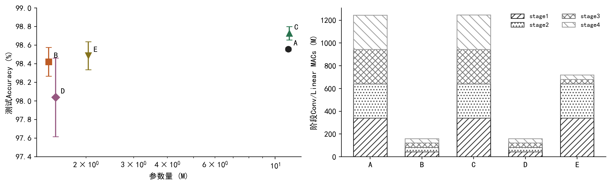

基线stage1的MACs占全模型27.19%。小图适配保留较高的浅层空间分辨率，使浅层成为重要计算来源。E的stage1/2仍分别需要339.739 M和301.990 M MACs，仅压缩深层虽能大幅减少参数，却保留了较多浅层计算。

### 4.2 收敛过程与验证波动

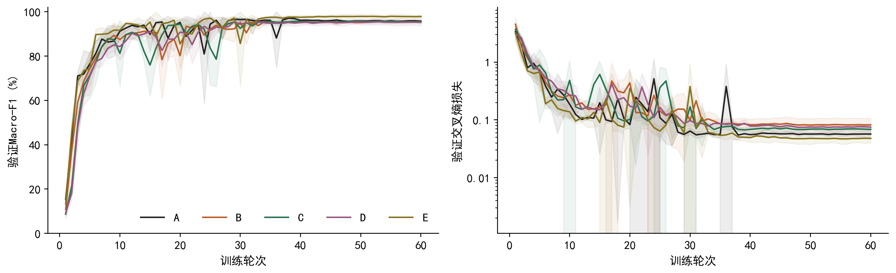

大多数运行后期达到较高验证指标，但平均曲线会掩盖个别种子的短暂回落。为定位这一现象，从第6轮起对所有保存日志的相邻轮次下降作描述性排序：

| 运行 | 轮次 | F1变化 pp | 验证损失前 → 后 |
| --- | --- | --- | --- |
| A / seed33 | 24 | -38.35 | 0.174 → 1.254 |
| B / seed22 | 17 | -31.87 | 0.200 → 1.038 |
| C / seed33 | 26 | -26.99 | 0.121 → 0.809 |

这些回落同时伴随验证损失上升，不能只视为某一类别的F1计算偶然变化。学习率阶段、优化过程、BN运行统计或序列分布均可能有关，但现有日志不足以区分机制。所有运行继续沿用既定验证选模规则，没有因为回落改用最后一轮，也没有按测试结果更换检查点。

### 4.3 每类错误与同图预测对比

| 对比 | 种子 | 修正原错误数 | 引入新错误数 | 净增加正确数 |
| --- | --- | --- | --- | --- |
| C-A | 11 | 85 | 73 | 12 |
| C-A | 22 | 64 | 34 | 30 |
| C-A | 33 | 79 | 56 | 23 |
| D-B | 11 | 64 | 136 | -72 |
| D-B | 22 | 85 | 59 | 26 |
| D-B | 33 | 61 | 160 | -99 |

“修正”指参照模型错误而比较模型正确，“引入”指相反方向。总精度的微小净差值可能由较多正向和反向变化相抵得到，不能解释为所有样本一致改善。

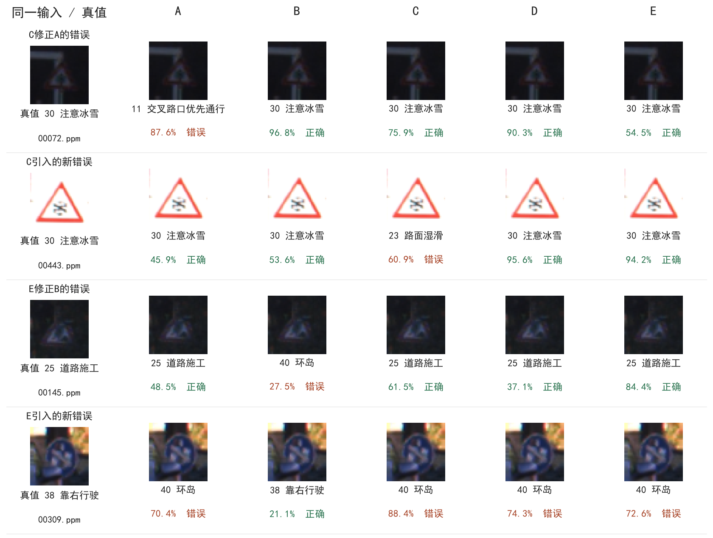

图7的四类案例分别取满足对应配对结果的样本ID排序首项；这是为解释错误变化而进行的事后选择，不代表总体成功或失败比例。图中的类别和未校准Top-1概率直接读取原始测试预测，未为展示重新推理或挑选最优种子。

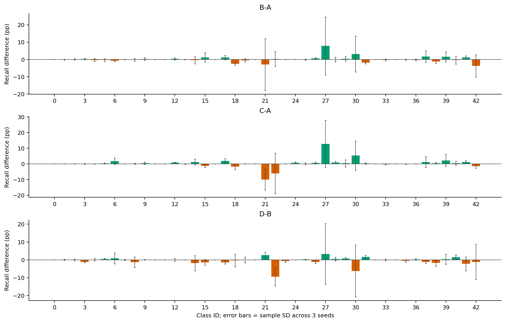

逐类别变化揭示了整体Accuracy之外的取舍。C-A在行人类上平均召回率变化为+12.78个百分点，而连续弯路类为-10.00个百分点；相应支持样本为60和90张。这些是对全部类别排序后的描述性极值，小支持类的少数图片变化就能明显改变召回率，不能将其解释为预先指定类别上的确定收益。

## 5 退化条件下的场景适配

### 5.1 五类退化的定量比较

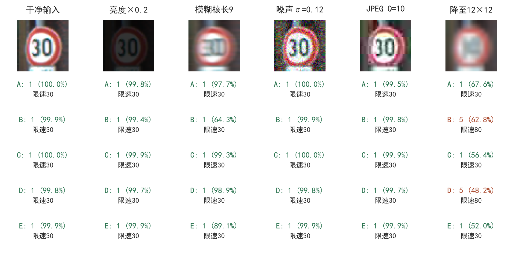

图9真值为1（限速30），按固定规则取干净输入上五组都正确、且至少一类最高强度退化引起模型分歧的首个样本ID。该图用于观察同一输入的变化，整体性能由全部测试图片评价：

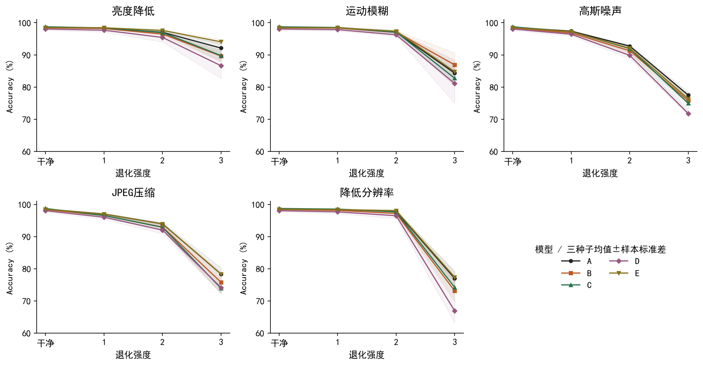

| 强度3退化 | A Accuracy % | B Accuracy % | C Accuracy % | D Accuracy % | E Accuracy % |
| --- | --- | --- | --- | --- | --- |
| 亮度降低 | 92.11 ± 1.51 | 89.63 ± 1.77 | 89.79 ± 1.73 | 86.62 ± 3.93 | 94.04 ± 0.80 |
| 运动模糊 | 84.34 ± 3.99 | 86.87 ± 3.77 | 82.73 ± 1.68 | 81.09 ± 6.21 | 84.76 ± 0.72 |
| 高斯噪声 | 77.47 ± 0.96 | 75.73 ± 1.03 | 74.96 ± 2.47 | 71.75 ± 0.50 | 76.29 ± 1.26 |
| JPEG压缩 | 78.32 ± 1.97 | 75.79 ± 3.24 | 73.90 ± 1.68 | 74.14 ± 1.82 | 78.33 ± 0.22 |
| 降低分辨率 | 76.99 ± 2.26 | 73.11 ± 3.42 | 74.19 ± 3.04 | 66.90 ± 3.68 | 77.37 ± 1.60 |

C在干净集上的微小优势没有转化为最高强度退化下的普遍优势，D在这些条件下也均未超过B。因此，SE改善干净分类不等价于改善所有退化鲁棒性。E在最高强度低亮度下高于A、B，而最高强度运动模糊下B更高；替换位置的收益依赖退化类型。这些观察支持按应用条件选择结构，而不能只按干净集单项分数排序。

亮度倍率只模拟部分低照度影响，水平模糊也不能代表所有相机运动。本节是固定合成退化的可控对照，未评价真实夜间、雨雾或完整车载流程。

### 5.2 同图Grad-CAM辅助观察

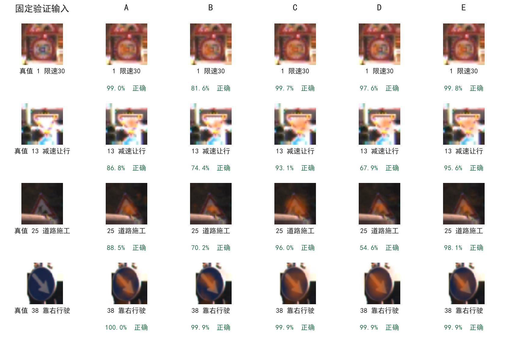

四张输入沿用正式测试前选定的验证样本，五组逐行观察相同图像。Grad-CAM使用stage3的12×12特征，避免stage4的6×6特征过于粗糙。每个模型解释自身Top-1类别的logit，因此若预测类别不同，热图的解释目标也不同。热图只能辅助检查模型响应区域，不能证明SE的因果作用，也不能把视觉上更集中的区域直接视为更可靠。

## 6 设备性能与道路场景应用

### 6.1 同一时段的GPU性能

| 组别 | 中位延迟 ms | P95 ms | 吞吐 images/s | 检查点 MB |
| --- | --- | --- | --- | --- |
| A | 9.700 | 11.036 | 2227.9 | 44.844 |
| B | 2.017 | 2.991 | 5147.2 | 5.912 |
| C | 10.363 | 11.478 | 2125.1 | 45.211 |
| D | 3.556 | 4.916 | 4710.7 | 6.279 |
| E | 2.779 | 3.521 | 3694.2 | 8.244 |

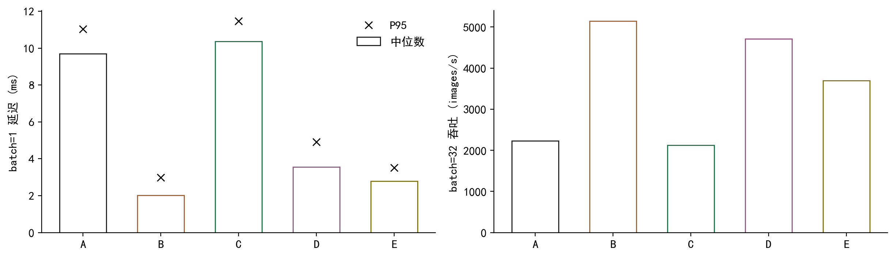

B的中位延迟相对A降低79.21%，说明DW在本硬件和测量配置下实现了实际加速。但计算量下降比例并不等于延迟下降比例；C、D在各自骨架上加入SE后延迟上升，其池化、通道缩放和算子调度开销不完全体现在本实验MACs口径中。E的中位延迟比B高37.78%，说明只压缩深层在当前GPU上没有获得B的速度水平。

模型在同一时段按A-E串行测量，没有随机交替顺序。显示任务、温度、功耗或其他负载仍可能影响结果，因此表中数值描述当前设备条件，不用于推断所有硬件或端到端应用延迟。

### 6.2 真实道路中的标注裁剪分类

为把应用评价从合成输入延伸至道路图像，使用GTSDB[5]固定公开镜像中的有标注子集。在模型推理前按文件名排序选择前100张有标注图像，保留全部标志框。按包含右下端点的ROI裁剪，不加上下文边缘，再沿用48×48预处理。与GTSRB全部标准化输入进行精确像素去重后，排除0张，保留163个裁剪，来自100张道路图像、36个有样本类别。原数据ReadMe允许任意用途；下载清单、镜像版本及逐图哈希保存在report/external/。

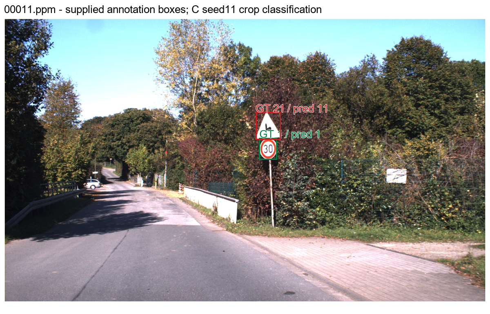

| 组别 | Accuracy % | 有样本类别Macro-F1 % | Top-3 Accuracy % |
| --- | --- | --- | --- |
| A | 96.32 ± 0.00 | 92.63 ± 0.30 | 97.96 ± 0.35 |
| B | 96.52 ± 0.35 | 93.27 ± 0.57 | 98.16 ± 0.61 |
| C | 96.32 ± 0.61 | 93.43 ± 0.59 | 97.96 ± 0.71 |
| D | 96.32 ± 0.00 | 92.96 ± 0.61 | 96.93 ± 0.61 |
| E | 97.34 ± 0.94 | 93.81 ± 0.62 | 97.96 ± 0.35 |

上表覆盖全部三个训练种子，不使用这些道路图片训练或选择检查点。Macro-F1只对该子集实际出现的类别取平均，与GTSRB的43类Macro-F1不可直接横比。E在本固定子集的平均Accuracy最高，但样本规模和类别支持有限，不能将其直接解释为部署中的普遍最优。

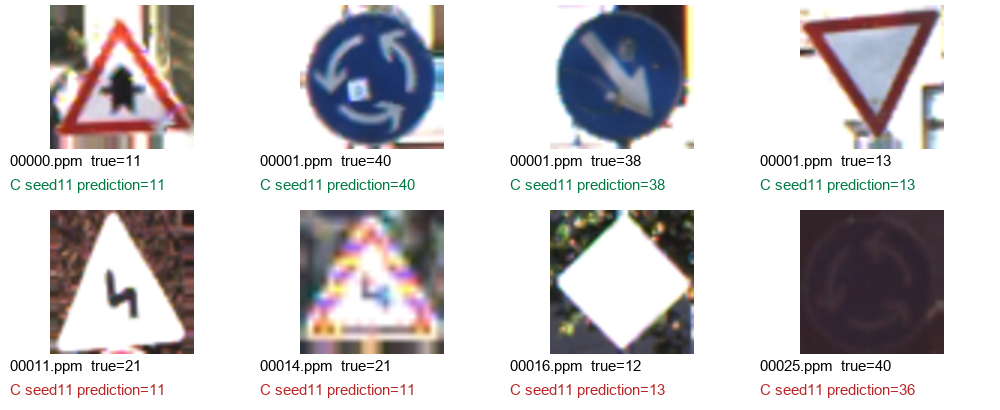

原道路图展示C组seed11首个错误案例所在场景；图14分别取正确与错误案例是为说明两类现象，不是总体比例的可视化。系统只评价已知标注框内分类，未实现道路图像中的自动目标定位。公开资料与精确像素去重尚不足以证明GTSDB和GTSRB在实体标志、相邻帧层面完全独立，本节定位为真实场景案例与分布变化分析，不作为严格独立的跨域基准。

### 6.3 应用入口与可复现产物

仓库提供图片上传、模型选择、Top-3预测、固定退化及Grad-CAM演示。输入应为裁剪后的已知类别标志；输出概率未经校准，应用没有可靠的未知类别拒识。复现入口和环境安装集中于README及docs/reproduction.md，报告只保留实验方法与证据链，避免在正文重复操作手册。

代码仓库：https://github.com/CYBEZM/gtsrb-resnet18-dw-se-coursework。每个run保留配置、环境、源码快照、日志、数据清单引用与最佳检查点校验值；逐样本预测记录样本ID、标签、类别与43类概率。当前报告和README共享同一汇总脚本，显示时舍入，底层保留未舍入值。

## 7 结论与局限

本实验完成了经典CNN的独立实现、结构修改和定量应用分析。B以较小的干净Accuracy变化大幅压缩参数与MACs，并在当前GPU上具有最低中位延迟；C的干净平均精度最高，但SE的收益依赖骨架和输入条件；D未获得组合收益，且训练随机性的波动更明显。E表明仅压缩深层能够形成另一种精度与资源取舍，在最高强度低亮度和固定道路子集上表现较好，同时保留较多浅层计算。模型选择因此应依据实际退化、设备与资源预算，不能将任一结构作为全场景最优。

本实验的证据边界包括：单一GTSRB版本与固定分组划分、三个训练种子、单一GPU平台，以及研究过程中提出的E探索对照。训练种子标准差不能覆盖数据版本、划分或实体标志相关性带来的不确定性。后续可在独立地点和时间采集数据，并用预先固定的假设与更多重复验证结构取舍；真实道路部署还需要目标定位、拒识和端到端延迟评估。

## 附录 主要数字与图像来源

| 对象 | 机器可读来源 |
| --- | --- |
| 干净精度 / 参数 / MACs | runs/{A-E}/{11,22,33}/{test_metrics.json,complexity.json} |
| 训练曲线 / 波动 / 逐类别分析 | runs/*/*/log.csv；report/deep_analysis/*.csv |
| 退化曲线 / 同图预测 | runs/*/*/robustness_metrics.json；predictions/*.npz |
| 当前五组设备计时 | report/supplement/contemporary_profiles/{A-E}.json |
| 道路结果 / 数据许可 / 输入 | report/external/{summary,input_protocol,source_manifest}.json |
| 新增图的选样、输入和权重哈希 | report/integrated/comparison_sources.json |
| 全文汇总与来源校验 | report/integrated/{summary,report_sources}.json |

## 参考文献

[1] He K, Zhang X, Ren S, Sun J. Deep Residual Learning for Image Recognition. CVPR, 2016. https://arxiv.org/abs/1512.03385

[2] Howard A G, et al. MobileNets: Efficient Convolutional Neural Networks for Mobile Vision Applications. 2017. https://arxiv.org/abs/1704.04861

[3] Hu J, Shen L, Sun G. Squeeze-and-Excitation Networks. CVPR, 2018. https://arxiv.org/abs/1709.01507

[4] Stallkamp J, Schlipsing M, Salmen J, Igel C. Man vs. computer: Benchmarking machine learning algorithms for traffic sign recognition. Neural Networks, 2012. https://doi.org/10.1016/j.neunet.2012.02.016

[5] Houben S, Stallkamp J, Salmen J, Schlipsing M, Igel C. Detection of Traffic Signs in Real-World Images: The German Traffic Sign Detection Benchmark. IJCNN, 2013. 数据原始说明与本文使用的镜像清单见report/external/source_manifest.json。
