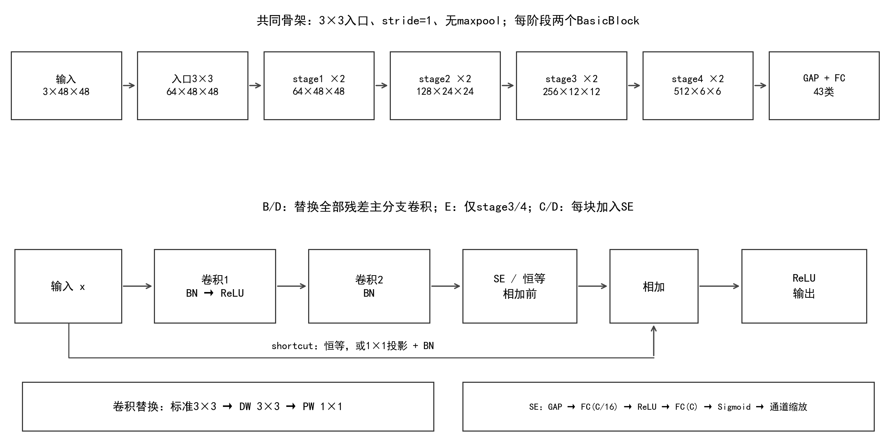
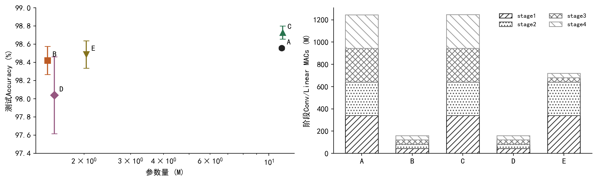
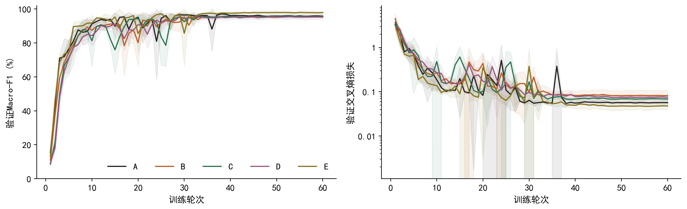
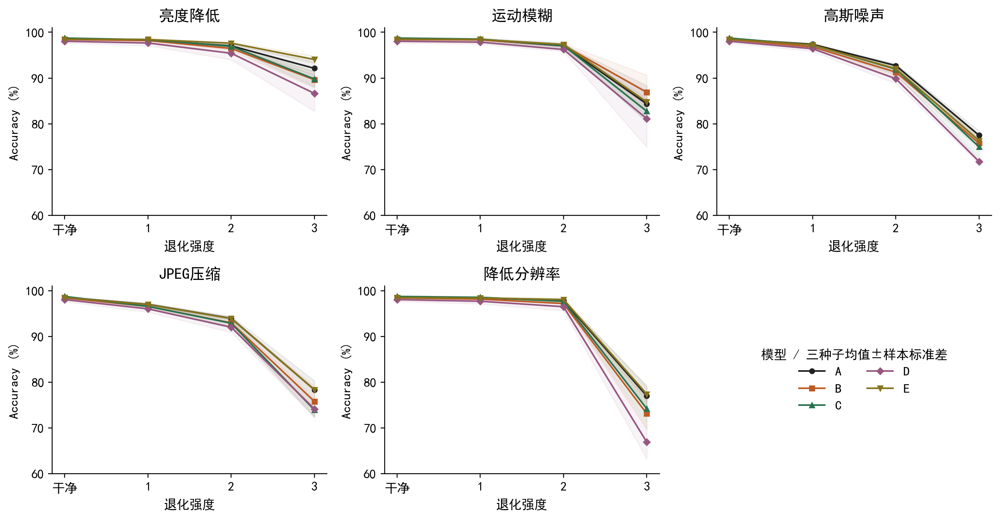
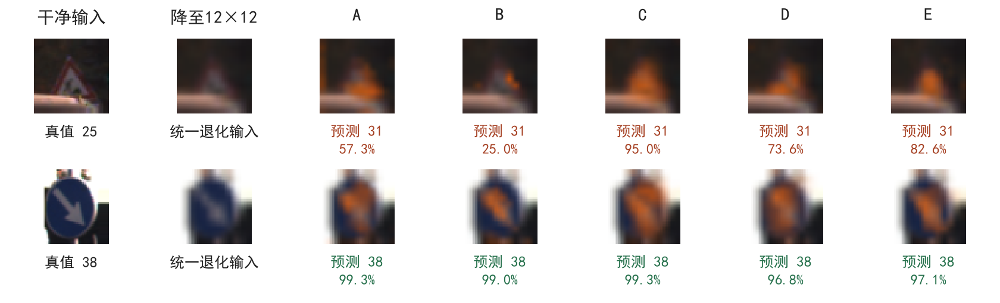
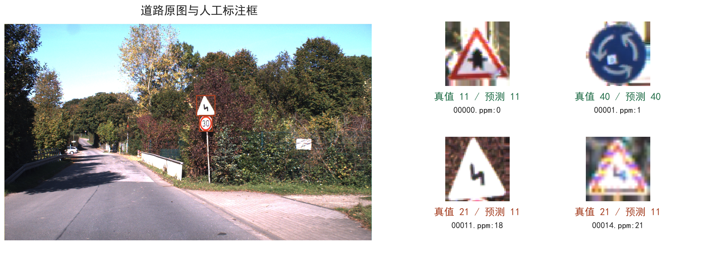

# 交通标志识别中残差CNN的轻量化、通道注意力与场景适配研究

内容整合稿 v2 · 供审阅，版式待调整

## 摘要

针对裁剪交通标志的多类别识别任务，本文从随机初始化实现小图像适配的ResNet-18，构建标准卷积、全阶段深度可分离卷积（DW）、SE通道注意力、DW与SE组合及深层局部DW五组结构。在统一数据划分、训练预算与验证选模规则下完成三个种子的重复训练，从干净分类、退化敏感性、参数与计算开销、GPU延迟及道路标注裁剪分类评价结构取舍。基线Accuracy为98.56 ± 0.02%，全阶段DW减少86.98%参数和86.85% MACs，配对Accuracy变化为-0.135个百分点；标准卷积加SE的干净Accuracy达到98.73 ± 0.07%，但收益未覆盖全部退化条件。结合卷积核的分解约束、浅深层的空间尺寸和设备实测分析可知，参数压缩、计算压缩与实际加速属于不同维度，组件组合也不保证精度收益相加。本文区分可由结构计算的结论、由实验观察的模式与尚待验证的机制，为具体场景中的CNN结构选择提供可复核依据。

关键词：ResNet-18；深度可分离卷积；SE；交通标志识别；鲁棒性

## 1 研究问题与技术路线

交通标志识别同时依赖外轮廓、颜色与内部细节。圆形边框有助于区分限速与警告标志，而相近限速数字、三角警告标志中的不同图案又要求模型保留局部差异。在低分辨率输入下，这些线索可能只占少量像素；亮度下降、模糊或压缩进一步改变线索的可见程度。因此，本任务不能只比较干净测试集上接近饱和的Accuracy，还需要分析模型使用多少资源、改错与新增错误如何抵消，以及输入条件变化后模型排序是否保持。

本文围绕三个问题展开：第一，将标准空间卷积分解为DW和PW后，能以多大精度代价压缩模型；第二，通道重标定能否在标准骨架与DW骨架上产生一致收益；第三，保留浅层标准卷积、仅压缩深层是否提供不同的精度与开销折中。实验先建立A-D两因素对照，再研究E的替换位置，最后将结构结论放入固定退化、目标GPU及道路标注裁剪中检验。模型、数据和训练规则尽量统一，讨论围绕每个问题组织，避免用大量单图案例代替总体证据。

方法基于ResNet[1]、深度可分离卷积[2]与SE[3]。本文的工作是经典CNN实现、组件改造与任务适配，不将已有模块的组合宣称为新的通用算法。与实验三的YOLO检测和超分辨率复现相比，本项目以图像分类网络的内部结构及其性能取舍为重点。

## 2 网络设计及其计算依据

### 2.1 小图输入、空间采样与感受野

基线保留ResNet-18的四阶段残差结构，每阶段两个BasicBlock，通道数为64、128、256、512。入口改为3×3、stride=1，并移除maxpool，四阶段空间尺寸依次为48×48、24×24、12×12、6×6，之后通过全局平均池化与全连接层输出43类。所有模型均从随机初始化训练；入口与shortcut投影在各组之间保持一致。

入口改动首先影响空间采样密度。对48×48输入，若直接沿用7×7、stride=2卷积和3×3、stride=2最大池化，入口输出为12×12，空间位置数只有输入的1/16；后续阶段将得到12、6、3、2的边长。这里的位置数减少不等价于“丢失同等比例的信息”，但较早合并相邻像素会降低网络继续分辨细小结构的空间粒度。保留高分辨率入口为数字笔画、边缘方向和小图案提供更多中间位置，代价是浅层激活与卷积开销增加。这是一种针对小图的设计理由，本文没有训练原始7×7入口对照，因而不把它表述为已经验证的精度提升。

感受野与采样密度需要分开考察。沿卷积主分支，令r为理论感受野边长、j为相邻特征位置在输入中的间隔，则经过核长k、步长s的层后，r_new = r_old + (k-1)×j_old，j_new = j_old×s。从r=1、j=1递推，当前入口的stage1至stage4感受野为11、25、53、109；原始入口的对应计算为43、99、211、435。适配网络在深层仍可覆盖整幅48×48输入，同时以更多空间位置保留中间表征。上述值是包含padding的最长卷积路径理论范围，不能解释为每个像素的实际贡献；SE还会通过全局池化引入跨位置依赖，因此该递推只用于分析卷积骨架，不能当作SE网络的完整依赖范围。

### 2.2 DW卷积的压缩来源与表达约束

标准k×k卷积在H×W输出上需要约H×W×k²×Cin×Cout次乘加。DW对每个输入通道独立进行空间滤波，再以PW的1×1卷积混合通道，对应H×W×(k²×Cin + Cin×Cout)。忽略偏置时，其卷积参数也按同样比例减少，相对计算量为1/Cout + 1/k²。入口、下采样投影与分类头未替换，因此整网压缩率应由实际模块统计，不能直接套用单层公式。

压缩并非来自通道宽度变窄：B与A的各阶段通道数相同。差别在于权重的参数化方式。本实现的DW depth multiplier为1，且DW/PW之间没有非线性；对单个被替换卷积，其等效核满足W[o,i,u,v] = P[o,i]×D[i,u,v]。固定输入通道i时，各输出通道的空间核由同一个D按比例组合，标准卷积则可以为每个输入输出通道对学习独立空间核。这说明DW+PW对单层核施加了分解约束，而不是简单地“每个通道必然更弱”。多层堆叠、通道混合与层间非线性仍能形成复杂特征，实际表达代价需要由任务结果判断。

### 2.3 SE位置与五组对照

SE先将每个通道的空间特征平均成一个描述量，再通过C→C/16→C的两层全连接、ReLU与Sigmoid生成通道权重。权重作用于残差主分支末端BN之后、相加之前。对于64、128、256、512通道，瓶颈维度分别为4、8、16、32。GAP使权重依赖整幅特征的通道均值，缩放又在空间上共享，所以SE能够调整通道响应的相对强弱，却不会单独恢复已经丢失的空间分辨率。

| 组别 | 主分支卷积 | SE | 主要比较 |
| --- | --- | --- | --- |
| A | 全部标准卷积 | 无 | 经典CNN基线 |
| B | 全部DW+PW | 无 | B-A：全阶段压缩 |
| C | 全部标准卷积 | 每块加入 | C-A：标准骨架加SE |
| D | 全部DW+PW | 每块加入 | D-B：DW骨架加SE |
| E | stage1/2标准，stage3/4 DW+PW | 无 | E-A、E-B：替换位置 |

A-D构成卷积类型与SE的完整两因素对照，E研究空间卷积分解发生在哪些层更合适。这样既能区分组件本身的效果，也能判断组合效果是否依赖骨架。各组共享通道宽度、残差拓扑与训练预算，保留比较的可解释性；但统一预算不意味着每种结构都已达到各自最优超参数。

## 3 数据与实验设置

### 3.1 数据划分及输入处理

GTSRB[4]使用Training_fixed版本，共26,640张供给训练图片，按类别和完整(class_id, track_id)分组为21,360张训练、5,280张验证，对应712和176条拍摄序列，分组交集为0。划分种子固定为2026，官方测试集12,630张、43类保持原状。该版本不同于常见的39,209张最终训练版本，结果不与不同数据供给条件直接等同。同一track内包含同一标志的连续帧，按完整序列分组能够避免相邻帧同时进入训练和验证；类别编号也纳入分组键，避免不同类别中重复的track编号被错误合并。

对GTSRB保留完整原图，不使用ROI裁剪；先以边缘像素补成正方形，再双线性缩放到48×48，按固定均值和标准差(0.5,0.5,0.5)归一化。补方保持标志几何比例，边缘填充则避免引入大面积人工黑框。训练逐图采用±10°旋转、±5%平移、0.95-1.05缩放与0.8-1.2亮度增强，不翻转；仿射采样使用双线性插值与边缘填充。类别分布及预处理样例另保存在仓库report/data/与report/integrated/。

### 3.2 训练规则与研究阶段

| 设置 | 五组统一取值 |
| --- | --- |
| 硬件 / 软件 | RTX 4060 Laptop 8GB；PyTorch 2.7.1+cu118；CUDA 11.8 |
| 初始化 / 重复 | 随机初始化；种子11、22、33 |
| 预算 / 批大小 | 60 epoch；batch=128 |
| 优化器 | SGD；momentum=0.9；weight_decay=0.0005 |
| 学习率 | 0.05；5轮预热后余弦下降至0.0001 |
| 数值精度 | 训练AMP FP16；验证和测试FP32，关闭TF32 |
| 检查点选择 | 验证Macro-F1最高；平局取更低损失，再平局取更早轮次 |

每次训练共用同一分组划分，根据验证集选择检查点，测试不参与选模。A-D先完成种子11，再在观察该种子结果后统一增加22、33；随后根据A-D结果提出E，并在执行E前单独冻结配置与比较规则。逐类别、训练波动与案例展示属于已保存结果的分析，没有据此调参或重选检查点。这是一项连续推进的研究，但并非全部比较都在首次测试前预注册。原协议和证据保留，沿革集中记录于docs/provenance.md，不在各结果章节重复说明。

### 3.3 指标、退化与计时口径

干净分类同时报告Accuracy与Macro-F1。前者按图片等权，后者先逐类计算F1再等权平均，可反映小样本类别的表现，因此总体Accuracy接近时仍可能出现不同Macro-F1排序。三个种子取均值与样本标准差（ddof=1）；结构差值先按相同种子配对再汇总，不选最佳种子。种子标准差描述训练随机性，不是置信区间，也未覆盖不同划分的不确定性。

鲁棒性评价在统一48×48输入上施加五类、各三档退化：亮度倍率0.7、0.4、0.2；水平运动模糊核长3、5、9；[0,1]像素上的高斯噪声标准差0.03、0.06、0.12；JPEG quality为50、25、10；先缩至32、24、12再双线性回采样到48。噪声由样本ID与固定协议生成，各模型及种子使用相同退化图片。五组、三种子、干净加15种退化，共240项GTSRB评价。退化的强度编号不具有跨类型的共同物理尺度，本文按类型解释曲线，不用混合平均分替代具体条件。

参数由实际模型计数，MACs只统计Conv2d与Linear，一次乘加记为1 MAC，不计BN、池化和逐元素操作。设备表统一引用同一时段的五组seed11检查点：FP32、TF32关闭、channels-last、eval与inference_mode、输入常驻GPU；预热50次、采样200次、重复3轮。batch=1用CUDA Events逐次同步计中位延迟与P95；batch=32连续执行并在计时边界同步测吞吐。表中取三轮统计量的中位数，不包含读图、预处理与传输，也不把计时重复解释为跨训练种子统计。

## 4 结构改动的结果与机制分析

### 4.1 总体精度与组件交互

| 组别 | Accuracy % | Macro-F1 % | 参数量 | MACs M |
| --- | --- | --- | --- | --- |
| A | 98.56 ± 0.02 | 97.35 ± 0.28 | 11,190,891 | 1249.712 |
| B | 98.42 ± 0.15 | 97.31 ± 0.31 | 1,456,555 | 164.371 |
| C | 98.73 ± 0.07 | 97.69 ± 0.33 | 11,279,971 | 1249.799 |
| D | 98.04 ± 0.42 | 96.88 ± 0.97 | 1,545,635 | 164.458 |
| E | 98.49 ± 0.15 | 97.18 ± 0.29 | 2,040,043 | 722.971 |

A建立了本实现、数据版本与训练预算下的参考水平。B在显著压缩资源量的同时保留接近的干净精度，说明此任务不需要完整标准卷积参数规模才能达到较高Accuracy。C的平均Accuracy与Macro-F1最高，但D低于B，表明SE的效果依赖其接收的特征骨架。E的Accuracy处于A、B之间，Macro-F1则未超过两者；保留浅层标准卷积没有让所有类别指标同步改善。

| 配对比较 | Accuracy差值均值 ± SD（pp） | 种子11 / 22 / 33（pp） |
| --- | --- | --- |
| B-A | -0.135 ± 0.137 | -0.206 / -0.222 / +0.024 |
| C-A | 0.172 ± 0.072 | +0.095 / +0.238 / +0.182 |
| D-B | -0.383 ± 0.521 | -0.570 / +0.206 / -0.784 |
| E-A | -0.069 ± 0.144 | +0.063 / -0.222 / -0.048 |
| E-B | 0.066 ± 0.180 | +0.269 / +0.000 / -0.071 |

C-A三个种子的Accuracy差值均为正，D-B却只有种子22为正。这能够支持“本实验中组合收益不一致”的描述，但三次重复不足以确立统计显著性或普遍结构规律。净精度差也并非对所有图像同向变化：C相对A在三种子上分别修正85、64、79张原错误，同时引入73、34、56张新错误。逐类分析中，C-A的行人类召回变化为+12.78个百分点（60张），连续弯路类为-10.00个百分点（90张）。这些是全部类别排序后的描述性结果，小支持类别的少量变动即可改变召回率，不能据此声称SE对某类必然有效。

从表征机制看，DW引入空间核分解约束，SE则对已生成的通道作全局缩放，两者改变的是不同环节。若某些区分类别所需的局部组合在前段提取不足，后置通道权重不能凭空生成这些空间结构；反之，若有用信息已经存在但通道响应混杂，重标定可能有助于突出差异。这为“同一个SE在不同骨架上效果不同”提供了结构上合理的解释，但没有测量特征可分性，不能据此确认D的实际失败原因。GAP对空间排列不同但通道均值相同的特征产生相同描述量，说明其空间摘要有信息约束；它也不意味着局部显著性一定被抹除，因为输入通道本身可能已经编码位置与形状。

SE瓶颈是否过窄同样需要实验。C与D使用相同通道数及r=16，C仍获得正向干净Accuracy差值，因此“C/16必然过度压缩”不能解释当前全部结果。残差输出仍为x + F(x) * s(F(x))，其中乘法为逐通道广播；恒等或投影shortcut始终存在。门控会改变主分支的响应及梯度，但不能直接推导为破坏残差梯度通路。若要区分分解约束、门控饱和与瓶颈维度的影响，需另行固定训练协议比较不同r，记录门控分布、梯度范数或中间特征；这些观测不在现有结果中，本文保留为待验证假设。

### 4.2 浅深层开销与E组的取舍

分层分析可解释为什么参数压缩率与计算压缩率不同。随着通道数增加，标准卷积参数大致随Cin×Cout增长；当通道近似翻倍而空间边长减半时，空间面积减为四分之一，恰好抵消近似四倍的通道乘积，所以后续各stage的MACs可以接近，并非深层分辨率低就必然计算更少。浅层更常保留局部边缘、颜色和方向线索，深层则组合更大范围的信息，这是解释结构选择的常用层次视角；本文没有直接验证各层只编码某一类特征。

实际计数中，A的stage1/2共有673,536个参数，占整网6.02%，却占51.35%的MACs。stage2、3、4各约301.990 M MACs，而stage1为339.739 M。浅层以较少的参数贡献约一半计算，深层则具有更大的权重规模与相近的阶段计算量，这是分辨率和通道共同作用的结果。

E把stage3/4改为DW后，整网参数由11,190,891降至2,040,043，减少81.77%；MACs由1249.712 M降至722.971 M，仅减少42.15%。保留的stage1/2在E中占88.76%的MACs，成为压缩后的主要计算来源。这解释了E为何能接近B的参数规模，却仍保留更多运算；其设备延迟高于B与这一结构差异一致，但实际延迟还取决于算子实现和数据移动，不能仅由MACs严格推算。

E与B的通道宽度、输入和分类头相同，差别集中于浅层卷积的参数化。保留浅层标准卷积可能保留更自由的局部空间与跨通道组合，而深层压缩优先节省权重。当前E在干净Accuracy上略高于B、Macro-F1略低，说明这种自由度并未转化为全指标优势。对E的评价应同时考虑存储、计算、类别表现与退化类型，不能把“保留浅层”自动解释为更优特征提取。

### 4.3 训练动态能说明什么

多数运行在后期达到较高验证指标，但早中期存在短暂回落，均值曲线会掩盖个体事件。第6轮起最大相邻回落出现在A的seed33第24轮，Macro-F1变化为-38.35个百分点，验证损失从0.174升至1.254。这说明至少部分回落伴随整体预测损失变化，不能只归因于F1对小类别敏感。

进一步逐run计算，D的三个种子最大相邻回落分别为-5.97、-11.64、-7.86个百分点；A对应为-16.35、-22.65、-38.35个百分点。因此，D最终测试结果的种子波动较大，不等同于D验证曲线的瞬时突降最大，更不能把其他组的回落用作DW+SE破坏梯度或陷入局部极小的证据。最终结果离散度、训练过程中回落和是否充分优化是三个不同问题，需要分别测量。

验证回落可能与优化轨迹、BN运行统计及训练和验证序列分布有关，现有日志未记录足够内部量进行归因。batch=128也不足以单独证明BN估计不稳定；固定60轮是公平计算预算，不等于已经证明D训练不足。后续若研究这些机制，应预先规定更长预算、学习率或归一化对照，并依据验证集选模。本次仍按原规则保留最佳验证检查点，未因解释需要增加训练或更换测试结果。

## 5 输入退化与场景适配

### 5.1 退化曲线中的结构差异

退化加重后模型排序并不始终沿用干净Accuracy排序。例如最高强度低亮度下，A为92.11 ± 1.51%，E为94.04 ± 0.80%；最高强度运动模糊下，B为86.87 ± 3.77%，E为84.76 ± 0.72%。局部替换因此表现为条件相关的折中，而非一致提升。C在干净集较高，却在五类最高强度退化中均低于A；D在这些条件下也均低于B，提示通道注意力没有自动带来退化不变性。

从输入变化看，亮度缩放主要改变强度和对比度范围，理想情况下仍保留边缘相对位置；运动模糊与降采样会混合相邻像素，使细小笔画和内部图形更难分离；JPEG量化引入的失真与高斯噪声又分别改变编码细节和随机局部响应。这些变化能够解释为什么同一精度水平的模型在不同退化上分化，但不能据此证明某个模型只依赖高频或低频线索。要作更强的特征依赖结论，需要频率干预、表征分析或额外受控对照。

SE权重由当前输入生成，退化可能同时改变类别特征与通道均值，从而改变门控。然而本实验没有保存逐样本SE权重，也没有测量退化前后的门控稳定性，所以“注意力错误放大了噪声”只能作为可检验的候选机制，不能当作对C或D下降的既定解释。同样，E的低亮度优势与保留浅层标准卷积相伴，但尚不足以建立两者的因果机制。实验能够确认的是各条件下的性能差异及其重复波动。

### 5.2 少量同图证据与可视化边界

图5从正式测试前固定的四张验证图像中，按索引保留道路施工和靠右行驶两张，统一使用最高强度降分辨率，不按预测结果选样。道路施工图在退化后被五组都判为类别31（注意野生动物），其中C的Top-1概率仍为95.0%；靠右行驶图则均正确。这同时展示了细节退化下的失败与保留较强方向轮廓时的成功；单一案例不能证明总体规律，但能提醒读者：高置信度和看似集中的热图并不保证分类正确。

热图使用stage3的12×12特征，每个模型解释自身预测类别的logit，并逐图归一化颜色范围。因此可观察响应位置，却不能直接比较不同模型橙色面积或绝对响应强度。本文不将Grad-CAM作为SE有效性的因果证据，也不以这两张图替代完整退化曲线。亮度缩放和水平模糊只是可控模拟，尚未覆盖真实夜间、雨雾、复杂运动或完整车载流程。

## 6 GPU开销与道路应用

### 6.1 实测性能与理论复杂度的差别

| 组别 | 中位延迟 ms | P95 ms | 吞吐 images/s | 检查点 MB |
| --- | --- | --- | --- | --- |
| A | 9.700 | 11.036 | 2227.9 | 44.844 |
| B | 2.017 | 2.991 | 5147.2 | 5.912 |
| C | 10.363 | 11.478 | 2125.1 | 45.211 |
| D | 3.556 | 4.916 | 4710.7 | 6.279 |
| E | 2.779 | 3.521 | 3694.2 | 8.244 |

B比A的中位延迟降低79.21%，低于其86.85%的MACs降幅；E的中位延迟比B高37.78%。这说明DW在当前设备确实实现加速，但理论运算压缩不能直接换算为相同比例的延迟下降。batch=1中位延迟衡量单图前向，batch=32吞吐体现批处理能力，二者不是同一工作负载，也不能把images/s的倒数当作单图交互延迟。

GPU耗时既可能受运算吞吐限制，也可能受数据搬运、算子调度和并行规模限制。算术强度指每传输一字节数据对应的浮点运算量。仅作理想化估算：对等宽通道的3×3、FP32卷积，假定每个输入输出元素只传输一次、忽略权重传输及缓存，并按1 MAC=2 FLOPs计算，DW的运算/字节比约为2.25 FLOPs/Byte；64通道标准卷积约为144 FLOPs/Byte。单层DW移除了跨输出通道的空间计算复用，因而在同等理想假设下算术强度更低。这解释了为什么减少MACs后，数据移动与启动固定开销可能更突出，而不是确认本GPU已经由访存主导。

本实现的DW后仍有PW，PW可提供不同的数据复用模式；BN、激活及多个中间张量也参与实际执行。小批量前向时，算子调度开销占比可能较高，较大batch又可能提高并行利用率。因此不能把整个B网络直接等同为纯访存受限，也不能仅从上述理想比值预测实际带宽利用率。确认瓶颈需要GPU profiler记录算子耗时、内存传输、带宽和占用率，本实验只测量总前向时间。

SE给A增加89,080个参数，约0.80%；同样的增量在B上占6.12%。它还引入空间归约、小型全连接、Sigmoid及逐通道缩放，这些操作的启动、归约和中间数据读写不由Conv/Linear MACs完整描述。C相对A中位延迟增加6.84%，D相对B增加76.32%。这些观测与额外算子开销相容，但没有算子级证据来确定每部分占比。本计时使用FP32且关闭TF32，未核验Tensor Core实际使用情况，不能宣称SE打断了Tensor Core流水线；也不能仅凭GAP或Sigmoid的名称推断非连续访存。

五组虽在同一时段测试，但顺序固定为A-E，未随机交替。温度、功耗和桌面负载仍可能影响排序与波动；表值适用于当前GPU与配置，不代表CPU、移动端或端到端应用。若部署以权重存储为约束，E具有不同价值；若本机单图延迟优先，B更有利；若干净精度优先，C在当前结果中更高。资源指标需要对应具体需求，不能由单一“轻量化”标签代替选择。

### 6.2 真实道路中的标注裁剪分类

道路应用使用GTSDB[5]固定公开镜像中按文件名排序的前100张有标注图像，规则在该子集推理前固定。保留全部标志框，按包含右下端点的ROI裁剪、不额外增加背景，再使用相同的补方和48×48处理。与GTSRB标准输入进行精确像素去重后排除0张，保留163个裁剪、36个有样本类别。此子集不用于训练或选模，原数据ReadMe允许任意用途；镜像版本、许可与逐图校验值保存在来源清单中。

| 组别 | Accuracy % | 有样本类别Macro-F1 % | Top-3 Accuracy % |
| --- | --- | --- | --- |
| A | 96.32 ± 0.00 | 92.63 ± 0.30 | 97.96 ± 0.35 |
| B | 96.52 ± 0.35 | 93.27 ± 0.57 | 98.16 ± 0.61 |
| C | 96.32 ± 0.61 | 93.43 ± 0.59 | 97.96 ± 0.71 |
| D | 96.32 ± 0.00 | 92.96 ± 0.61 | 96.93 ± 0.61 |
| E | 97.34 ± 0.94 | 93.81 ± 0.62 | 97.96 ± 0.35 |

五组均能在该固定裁剪子集保持较高Accuracy，E的均值最高，但样本量与逐类支持有限。这里的Macro-F1只对出现的类别取平均，与GTSRB的43类口径不同；不同标注框范围也会改变模型看到的背景与标志比例，因此分数变化不能只归因于道路背景。

复合图联系道路背景与局部成功、失败：正确与错误分别选样用于解释两类现象，不呈现总体比例。分类器使用已知标注框，不具备整幅道路图像自动定位能力；精确去重也不足以证明GTSDB与GTSRB在实体标志或相邻帧层面完全独立。因此本节提供真实场景案例与分布变化分析，尚不能作为严格独立的跨域部署结论。应用入口支持裁剪标志上传、模型选择、Top-3和退化演示，概率未校准，也未实现可靠未知类别拒识。

## 7 结论、证据边界与复现

本实验表明，在给定GTSRB版本和统一训练预算下，DW可用较小的干净Accuracy变化换取较大的参数、计算与当前GPU延迟下降；SE在标准骨架上改善干净分类，却没有在DW骨架或最高强度退化下形成一致收益。仅替换深层的E保留较多浅层计算，获得另一种参数与场景表现折中。这些发现的共同含义是：层级位置、特征参数化与部署工作负载会共同改变结构价值，组件收益不能直接相加。

机制分析中，空间尺寸、理论感受野、分层参数和MACs可从代码计算；准确率、训练回落和GPU延迟来自保存结果；门控饱和、特征丢失以及具体GPU瓶颈则仍是假设。区分三者可以使解释更深入，同时避免把合理叙事写成未经验证的因果结论。当前证据还受单一固定划分、三个种子、单一硬件和E的事后探索性质限制。进一步验证应在独立地点与时间数据上固定假设，分别研究SE瓶颈、训练预算及设备瓶颈，真实部署还需检测、拒识和端到端性能评估。

代码仓库：https://github.com/CYBEZM/gtsrb-resnet18-dw-se-coursework。安装、训练、暂停恢复和报告生成命令集中于README及docs/reproduction.md。每次run保留配置、环境、源码快照、数据引用、日志与检查点哈希；报告和README共享机器汇总，指标显示时才舍入，原始证据未修改。

## 附录 结果与推导来源

干净精度与复杂度：runs/{A-E}/{11,22,33}/{test_metrics.json,complexity.json}；退化：同目录robustness_metrics.json及predictions/*.npz；训练：log.csv；逐类与配对错误：report/deep_analysis/*.csv；设备计时：report/supplement/contemporary_profiles/{A-E}.json。

分层计数、理论感受野和逐run回落：report/integrated/component_analysis.json，由make_compact_evidence.py计算，感受野为结构推导而非新增训练；精简案例的输入、权重和选样：compact_sources.json；道路：report/external/{summary,input_protocol,source_manifest}.json；全文汇总与来源校验：report/integrated/{summary,report_sources,audit}.json。未纳入正文的旧图和完整逐图案例仍可在仓库中查阅。

## 参考文献

[1] He K, Zhang X, Ren S, Sun J. Deep Residual Learning for Image Recognition. CVPR, 2016. https://arxiv.org/abs/1512.03385

[2] Howard A G, et al. MobileNets: Efficient Convolutional Neural Networks for Mobile Vision Applications. 2017. https://arxiv.org/abs/1704.04861

[3] Hu J, Shen L, Sun G. Squeeze-and-Excitation Networks. CVPR, 2018. https://arxiv.org/abs/1709.01507

[4] Stallkamp J, Schlipsing M, Salmen J, Igel C. Man vs. computer: Benchmarking machine learning algorithms for traffic sign recognition. Neural Networks, 2012. https://doi.org/10.1016/j.neunet.2012.02.016

[5] Houben S, Stallkamp J, Salmen J, Schlipsing M, Igel C. Detection of Traffic Signs in Real-World Images: The German Traffic Sign Detection Benchmark. IJCNN, 2013. 数据原始说明与本文使用的镜像清单见report/external/source_manifest.json。
